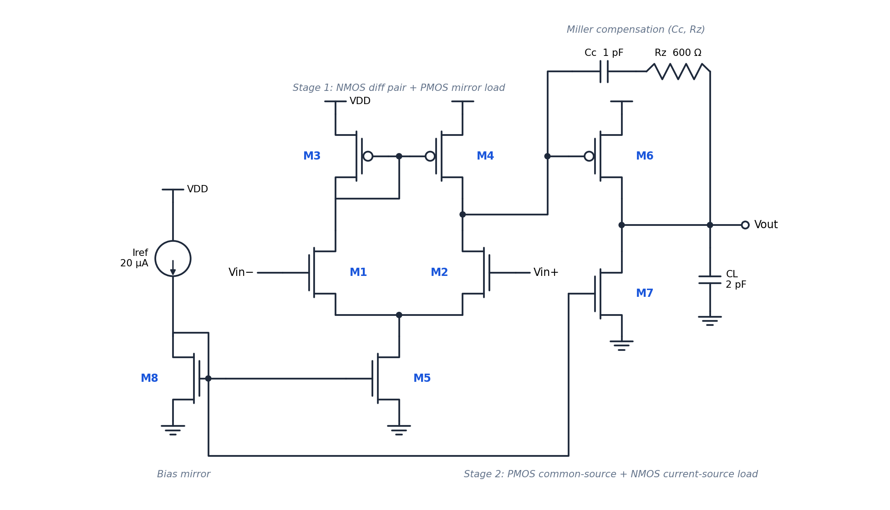
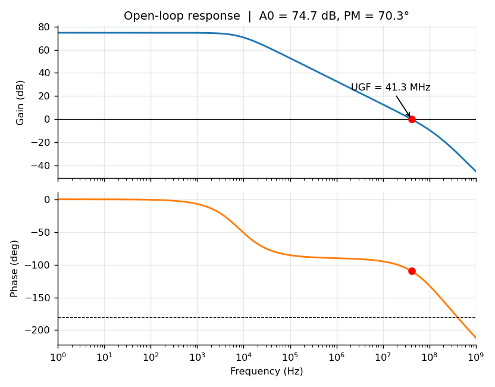
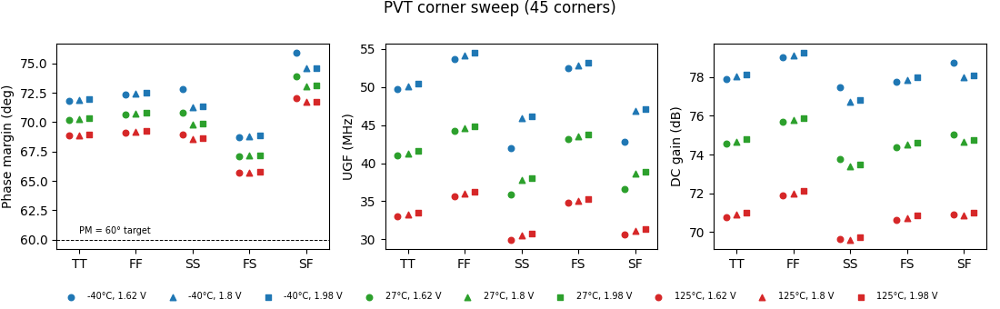
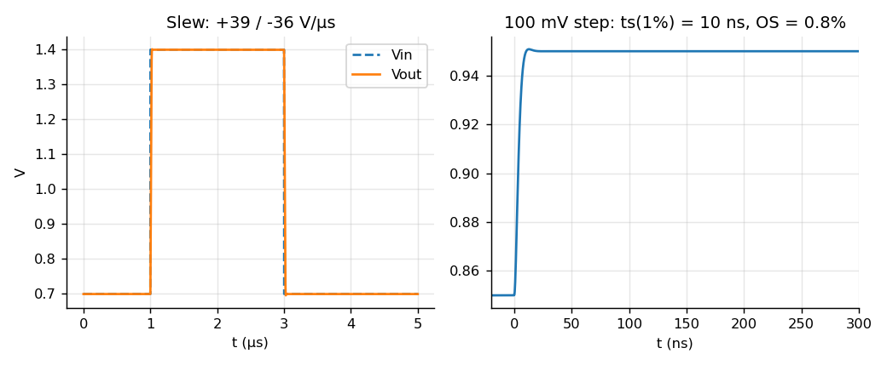
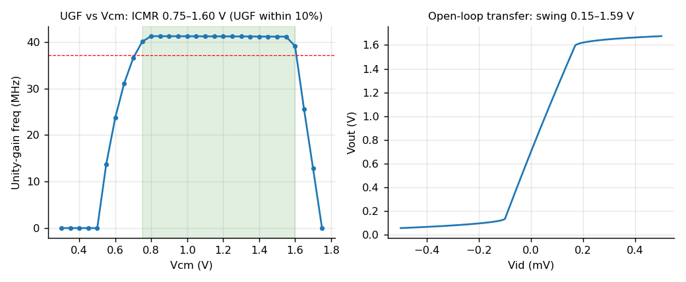
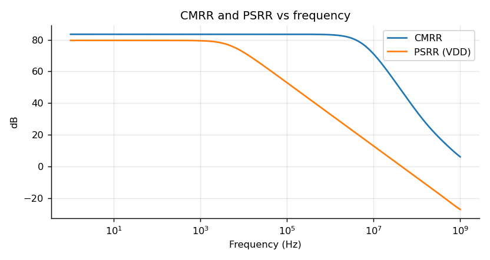
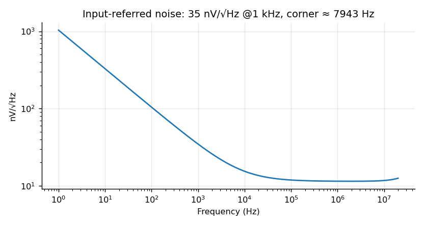
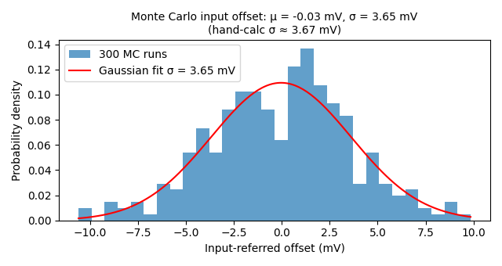

# Two-Stage Miller-Compensated CMOS Op-Amp

Transistor-level design, simulation and verification of a two-stage CMOS operational amplifier in **ngspice**, with hand-calculation cross-checks, a 45-corner PVT sweep and a 300-sample Monte Carlo mismatch analysis. Every number below is regenerated by one command: `python scripts/run_all.py`.



## Results (VDD = 1.8 V, CL = 2 pF, TT, 27 °C)

| Metric | Result |
|---|---|
| DC gain | **74.7 dB** |
| Unity-gain frequency | **41.3 MHz** |
| Phase margin / gain margin | **70.3° / 29.3 dB** |
| Slew rate (rise / fall) | 38.9 / 35.5 V/µs |
| 1 % settling time (100 mV step) / overshoot | 9.5 ns / 0.8 % |
| CMRR / PSRR (1 kHz) | 83.5 dB / 79.4 dB |
| Input common-mode range | 0.75 – 1.6 V |
| Output swing | 0.15 – 1.59 V |
| Input-referred noise | 34.7 nV/√Hz @ 1 kHz, 11.7 nV/√Hz thermal floor |
| Supply current / power | 263 µA / 473 µW |
| Systematic offset | −36 µV |

**Robustness**

| Analysis | Result |
|---|---|
| PVT corners (5 process × 3 VDD × 3 T = 45) | PM ≥ **65.7°** (worst: FS, 1.62 V, 125 °C); A0 69.6 – 79.2 dB; UGF 30 – 54 MHz; Idd 252 – 267 µA |
| Monte Carlo mismatch (300 runs, A_VT = 5 mV·µm) | input offset σ = **3.65 mV** (hand calculation: 3.67 mV), 3σ ≈ 11 mV |

## Plots

| | |
|---|---|
|  |  |
|  |  |
|  |  |
|  | |

## Design in one paragraph

An NMOS differential pair with a PMOS current-mirror load drives a PMOS common-source second stage biased by a 10× NMOS current mirror. A Miller capacitor (1 pF) splits the poles; a series nulling resistor (600 Ω, slightly above 1/gm6) converts the Miller right-half-plane zero into a left-half-plane zero for extra phase lead. Devices are sized by hand from GBW, slew rate and the second-pole placement rule, then verified in simulation. See [`docs/design_notes.md`](docs/design_notes.md) for the sizing procedure and a **hand-calculation vs simulation table** (gain within 2 dB, GBW within 10 %, thermal noise within 3 %, offset σ within 1 %).

## Repository layout

```
netlists/   opamp.cir (subcircuit), models.lib, corner.inc, one testbench per spec (tb_*.cir)
scripts/    run_typical.py  run_corners.py  run_montecarlo.py  draw_schematic.py  run_all.py  spice.py
results/    plots, summary JSON/CSV (regenerated by the scripts)
docs/       schematic.png, design_notes.md
```

## Reproduce

```bash
sudo apt install ngspice          # or: brew install ngspice
pip install -r requirements.txt
python scripts/run_all.py         # ~1–2 min
```

Testbench netlists can also be run directly, e.g. `cd netlists && ngspice tb_ac_open_loop.cir`.

## Verification notes

* **Open-loop AC** uses a 1 GH inductor to close the loop at DC only, so the amplifier is biased at its true operating point while the AC loop stays open.
* **Slew/settling** are measured in a unity-gain follower with step levels kept inside the input range. (An earlier version stepped below the ICMR, the input pair shut off, and the waveform exposed it; documented in the design notes.)
* **ICMR** is defined by the unity-gain frequency staying within 10 % of its mid-supply value, i.e. gm1 constant and all devices saturated, and agrees with the analytic limits (VGS1 + VDSAT5 low, VDD − |VSG3| + VTn high).

## Limitations

Generic Level-1 MOS models (not a foundry PDK), no layout parasitics, ideal bias current source, NMOS-only input pair, empirically chosen 1/f coefficient. Absolute numbers are therefore not silicon predictions; trends, trade-offs and agreement with hand analysis are the point.

## Next steps

* Port to an open-source PDK (e.g. SkyWater sky130) with BSIM models and re-verify.
* Use the op-amp as the error amplifier of a low-dropout regulator (loop stability vs load current, PSRR).
* Add an on-chip bias generator (beta multiplier) and re-run PSRR.
* Rail-to-rail complementary input stage.
* Layout in Magic/KLayout with post-layout simulation.

## License

MIT
